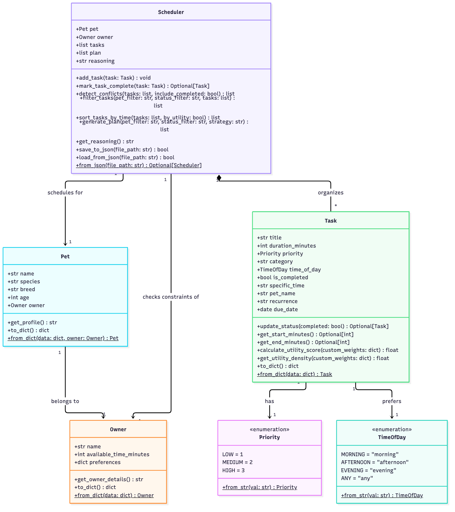
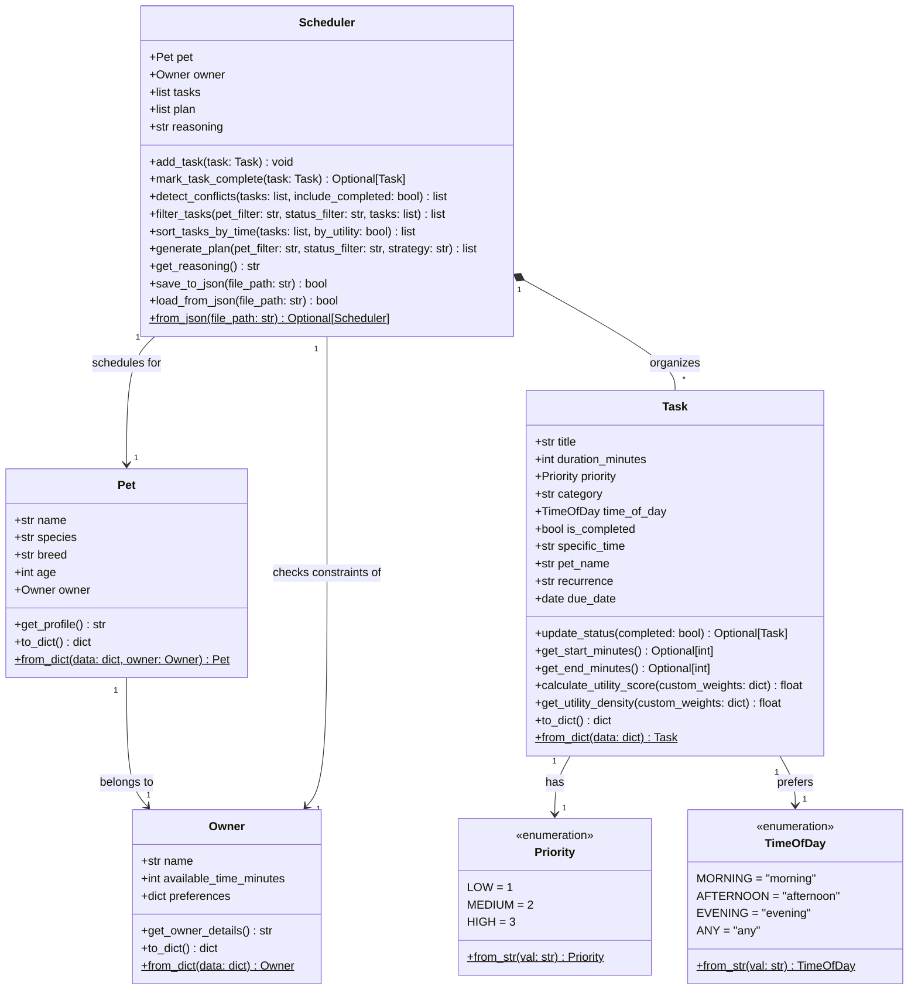

# 🐾 PawPal+ — Smart Pet Care Planner

PawPal+ is a Streamlit and CLI-powered scheduling assistant designed to help busy pet owners maintain consistency in their companion's care. By analyzing daily time constraints, preferred windows, and precise time blocks, PawPal+ generates an optimized daily care plan and provides clear explanations of its scheduling choices.

A busy pet owner needs help staying consistent with pet care. They want an assistant that can:

- Track pet care tasks (walks, feeding, meds, enrichment, grooming, etc.)
- Consider constraints (time available, priority, owner preferences)
- Produce a daily plan and explain why it chose that plan

PawPal+ app allows a user to:

- Enter basic owner + pet info
- Add/edit tasks (duration + priority at minimum)
- Generate a daily schedule/plan based on constraints and priorities
- Display the plan clearly (and ideally explain the reasoning)
- Include tests for the most important scheduling behaviors

---

## ✨ Features

- **🕒 Constraint-Aware Scheduling**: Evaluates the owner's daily available time limit and schedules tasks without exceeding the time budget.
- **🧮 Multi-Factor Utility & Knapsack Optimization**: Supports 3 scheduling strategies: **Priority Greedy**, **Weighted Multi-Factor Utility** (knapsack-greedy density packing), and **Optimal Knapsack** (0/1 Knapsack Dynamic Programming maximizing total care utility within caregiver time budget).
- **💾 Atomic JSON Data Persistence**: Remembers pets, constraints, and tasks across application runs via `data.json` using atomic writes (`.tmp` + `os.fsync` + `os.replace`) with schema drift tolerance and per-record error isolation.
- **📊 Visual Analytics Dashboard**: Altair-powered care category distribution donut chart, live time budget utilization progress bar, and 4 real-time KPI metric cards (Scheduled Tasks, Scheduled Time, Budget, Care Utility Score).
- **⚡ Interval-Based Gap-Filling**: Intelligently slots flexible tasks around fixed-time appointments to maximize time utilization.
- **⚠️ Basic Conflict Detection**: Scans the pool for overlapping specific start times and raises warnings in the UI before schedule generation.
- **🔄 Recurring Task Rollovers**: Automatically spawns the next occurrence (calculated via Python `timedelta` for daily/weekly intervals) when a task is checked off as completed.
- **🐾 Multi-Pet Schedules**: Supports sorting and filtering the care task pool and generated schedules by specific pets or shared activities.

---

## 📐 UML Class Diagram

Below is the finalized UML class diagram showing the system architecture, relationships, attributes, and methods of the core entities (`Owner`, `Pet`, `Task`, `Scheduler`, `Priority`, and `TimeOfDay`), including recent multi-factor scoring and atomic JSON persistence capabilities:



<details>
<summary>🔍 Click to view interactive Mermaid UML definition</summary>


</details>

---

## ⚙️ Smarter Scheduling Engine

The scheduling core in [pawpal_system.py](pawpal_system.py) implements the following features:

### 1. Chronological & Priority Task Sorting
*   **Method**: `Scheduler.sort_tasks_by_time(tasks, by_utility=False)`
*   **Behavior**: Sorts tasks by placing fixed-time tasks (those with specific `HH:MM` start times) chronologically first. Flexible tasks are ordered next based on their preferred time window (`Morning` -> `Afternoon` -> `Evening` -> `Any`) and sub-sorted by Priority (`High` -> `Medium` -> `Low`) or value density when `by_utility=True`.

### 2. Multi-Pet & Status Filtering
*   **Method**: `Scheduler.filter_tasks(pet_filter, status_filter, tasks)`
*   **Behavior**: Filters any task list by ownership (matching specific pet name or shared `"All"` tasks) and completion status (`Pending` vs `Completed`).

### 3. Basic Conflict Detection
*   **Method**: `Scheduler.detect_conflicts(tasks, include_completed=True)`
*   **Behavior**: Scans for overlapping fixed time blocks. Any overlaps are flagged as warnings in the UI and automatically skipped during schedule generation to avoid double-booking.

### 4. Recurring Task Auto-Generation
*   **Methods**: `Task.update_status(completed)` & `Scheduler.mark_task_complete(task)`
*   **Behavior**: Transitioning a `"daily"` or `"weekly"` task to completed automatically instantiates a new, pending `Task` instance for the next occurrence (using `timedelta` to calculate `today + 1 day` or `today + 7 days`).

### 5. Multi-Factor Scoring & 0/1 Knapsack Optimization
*   **Methods**: `Task.calculate_utility_score()`, `Task.get_utility_density()`, & `Scheduler.generate_plan(strategy=...)`
*   **Behavior**: Evaluates tasks using composite utility points `(Priority × Category Weight) + Recurrence Bonus`. Offers three scheduling strategies: **Priority Greedy**, **Weighted Multi-Factor Utility** (knapsack-greedy density packing), and **Optimal Knapsack** (0/1 Knapsack Dynamic Programming maximizing total care value within caregiver time budget).

### 6. Atomic JSON Persistence & Defensive Storage
*   **Methods**: `Scheduler.save_to_json(file_path)`, `Scheduler.load_from_json(file_path)`, & `Scheduler.from_json(file_path)`
*   **Behavior**: Persists full application state to `data.json` atomically (via `.tmp` files, disk flush, `os.fsync`, and `os.replace`). Implements per-record error isolation against corrupted records and schema drift.

---

## 🚀 Getting Started

### 1. Setup & Installation
Clone the repository and install dependencies in a virtual environment:
```bash
python -m venv .venv
source .venv/bin/activate  # Windows: .venv\Scripts\activate
pip install -r requirements.txt
```

### 2. Run the Streamlit Application
Launch the visual web dashboard:
```bash
streamlit run app.py
```

### 3. Run the CLI Demo
Run the command-line entry point to print pool conflicts and schedule planning skips to the terminal:
```bash
python3 main.py
```

---

## 📸 Demo Walkthrough

### 1. Executive Top Bar
* The header displays live profile context badges: caregiver (`Jordan`), primary pet (`Mochi (Cat, 2yo)`), and live time budget utilization (`80 / 120m scheduled (67%)`).

### 2. Tab 1: 📅 Daily Schedule & Visual Analytics
* **Strategy Selection & Filters**: Filter tasks by pet and status. Choose between three optimization strategies: **Weighted Multi-Factor Utility** (default), **Optimal Knapsack**, or **Priority Greedy**, and click `🔄 Recalculate`.
* **KPI Metrics & Visual Analytics**: Review the 4 metric cards (`Scheduled Tasks`, `Scheduled Time`, `Available Budget`, `Care Utility Score`) alongside the Altair care category distribution donut chart and time budget progress bar.
* **Chronological Timeline**: Color-coded cards show scheduled times, task titles, duration, priority badges (`HIGH`, `MEDIUM`, `LOW`), pet tags, and recurrence indicators.
* **Scheduling Reasoning**: Expand `🧠 Scheduling Engine Reasoning` to view step-by-step logs explaining exactly which tasks were scheduled, which conflicted, and which were skipped.

### 3. Tab 2: 📋 Task Pool & Builder
* **Add Pet Care Tasks**: Use the compact task builder form on the left to configure duration (minutes), priority level, category (walk, feeding, meds, enrichment, grooming), associated pet, preferred time window, recurrence, and optional specific start time (e.g. `08:30`).
* **Conflict Warning Banner**: Overlapping fixed-time appointments immediately trigger a `⚠️ Time Conflict Warning in Pool` alert.
* **Interactive Checklist & Management**: Check off tasks as completed (which automatically spawns the next occurrence for daily/weekly recurring tasks), delete individual tasks with `🗑️`, or use bulk actions (`🗑️ Clear`, `🔄 Reset Recurring`). All changes auto-persist to `data.json`.

### 4. Tab 3: 👤 Pet Settings & Constraints
* **Profiles & Limits**: Update caregiver name, daily available care budget (minutes), and primary pet details (species, breed, age).
* **Storage & Persistence**: Under `💾 Storage & Data Persistence`, use `💾 Force Save to data.json` or `📥 Reload from data.json` to synchronize state between sessions with atomic file write protection.

---

## 🧪 Testing PawPal+

To run the automated test suite of 26 tests (covering edge cases like boundary conflicts, tie-breakers, date rollovers, multi-factor utility scoring, knapsack optimization, atomic JSON persistence, and schema drift):

```bash
python -m pytest -v
```

### Sample Test Output:
```text
=========================== test session starts ============================
platform darwin -- Python 3.13.9, pytest-8.3.4, pluggy-1.5.0 -- /opt/anaconda3/bin/python
cachedir: .pytest_cache
rootdir: /Users/wizofoz/Documents/FAU/2026-2 Fall/CODEPATH_AI01_Foundation/WEEK3/ai110-module2show-pawpal-starter
plugins: anyio-4.12.1
collected 26 items                                                         

tests/test_pawpal.py::test_owner_pet_creation PASSED                 [  3%]
tests/test_pawpal.py::test_priority_timeofday_from_str PASSED        [  7%]
tests/test_pawpal.py::test_task_status_update PASSED                 [ 11%]
tests/test_pawpal.py::test_scheduler_task_addition PASSED            [ 15%]
tests/test_pawpal.py::test_scheduler_greedy_time_constraint PASSED   [ 19%]
tests/test_pawpal.py::test_task_time_parsing PASSED                  [ 23%]
tests/test_pawpal.py::test_conflict_detection PASSED                 [ 26%]
tests/test_pawpal.py::test_filtering_by_pet_and_status PASSED        [ 30%]
tests/test_pawpal.py::test_interval_gap_filling PASSED               [ 34%]
tests/test_pawpal.py::test_recurring_task_auto_spawning PASSED       [ 38%]
tests/test_pawpal.py::test_sorting_correctness_suite PASSED          [ 42%]
tests/test_pawpal.py::test_recurrence_logic_suite PASSED             [ 46%]
tests/test_pawpal.py::test_conflict_detection_suite PASSED           [ 50%]
tests/test_pawpal.py::test_zero_and_constrained_budget_edge_cases PASSED [ 53%]
tests/test_pawpal.py::test_time_fragmentation_edge_case PASSED       [ 57%]
tests/test_pawpal.py::test_fallback_window_edge_case PASSED          [ 61%]
tests/test_pawpal.py::test_multi_factor_utility_scoring PASSED       [ 65%]
tests/test_pawpal.py::test_weighted_utility_density_strategy PASSED  [ 69%]
tests/test_pawpal.py::test_optimal_knapsack_maximization PASSED      [ 73%]
tests/test_pawpal.py::test_sort_tasks_by_utility PASSED              [ 76%]
tests/test_pawpal.py::test_json_persistence_roundtrip PASSED         [ 80%]
tests/test_pawpal.py::test_json_persistence_atomic_write PASSED      [ 84%]
tests/test_pawpal.py::test_json_persistence_missing_file PASSED      [ 88%]
tests/test_pawpal.py::test_json_persistence_corrupt_file PASSED      [ 92%]
tests/test_pawpal.py::test_json_persistence_schema_drift_and_record_isolation PASSED [ 96%]
tests/test_pawpal.py::test_task_dict_serialization_defensive PASSED  [100%]

============================ 26 passed in 0.05s ============================
```

---

## 🖥️ Sample CLI Output

Here is the terminal output from running `python3 main.py` with conflicting tasks at `08:00`:

```text
=== 1. ALL POOL TASKS (AS ADDED - OUT OF ORDER) ===
  • [Mochi] Mochi Evening Brush (15m) in evening [Priority: LOW]
  • [Biscuit] Biscuit Afternoon Walk (30m) in afternoon [Priority: HIGH]
  • [Mochi] Mochi Morning Feed (15m) at 08:00 [Priority: HIGH]
  • [Biscuit] Biscuit Morning Walk (25m) at 08:00 [Priority: HIGH]
  • [All] Shared Playtime (20m) in afternoon [Priority: MEDIUM]

=== RUNNING POOL CONFLICT DETECTION ===
⚠️  Warning: Detected schedule time conflicts in the task pool!
  - Conflict: 'Mochi Morning Feed' (08:00) overlaps with 'Biscuit Morning Walk' (08:00)

=== 2. FILTERED TASKS (PET: MOCHI + SHARED) ===
  • [Mochi] Mochi Evening Brush (15m) in evening [Priority: LOW]
  • [Mochi] Mochi Morning Feed (15m) at 08:00 [Priority: HIGH]
  • [All] Shared Playtime (20m) in afternoon [Priority: MEDIUM]

=== 3. FILTERED & CHRONOLOGICALLY SORTED TASKS (PET: MOCHI) ===
  • [Mochi] Mochi Morning Feed (15m) at 08:00 [Priority: HIGH]
  • [All] Shared Playtime (20m) in afternoon [Priority: MEDIUM]
  • [Mochi] Mochi Evening Brush (15m) in evening [Priority: LOW]

=== 4. GENERATED PLAN FOR MOCHI (FILTERED & CONSTRAINED) ===

┌────────────────────────────────────────────────────────────────────────┐
│                    🐾 TODAY'S PET CARE PLAN: JORDAN                     │
└────────────────────────────────────────────────────────────────────────┘
  Time Budget: 120 mins | Scheduled: 50 mins (41.7% Used)
  Progress:    [████████████░░░░░░░░░░░░░░░░░░]

┌──────────────┬──────────────────────────────┬────────────┬─────────────┐
│ TIME SLOT    │ TASK DESCRIPTION             │ DURATION   │ PRIORITY    │
├──────────────┼──────────────────────────────┼────────────┼─────────────┤
│ 08:00 - 08:15 │ 🥣 Mochi Morning Feed         │ 15 min     │ HIGH        │
│ 12:00 - 12:20 │ 🧸 Shared Playtime            │ 20 min     │ MEDIUM      │
│ 17:00 - 17:15 │ ✂️ Mochi Evening Brush       │ 15 min     │ LOW         │
└──────────────┴──────────────────────────────┴────────────┴─────────────┘


=== 5. GENERATED PLAN FOR ALL PETS (WITH CONFLICT TRIGGERED) ===

┌────────────────────────────────────────────────────────────────────────┐
│                    🐾 TODAY'S PET CARE PLAN: JORDAN                     │
└────────────────────────────────────────────────────────────────────────┘
  Time Budget: 120 mins | Scheduled: 80 mins (66.7% Used)
  Progress:    [████████████████████░░░░░░░░░░]

┌──────────────┬──────────────────────────────┬────────────┬─────────────┐
│ TIME SLOT    │ TASK DESCRIPTION             │ DURATION   │ PRIORITY    │
├──────────────┼──────────────────────────────┼────────────┼─────────────┤
│ 08:00 - 08:15 │ 🥣 Mochi Morning Feed         │ 15 min     │ HIGH        │
│ 12:00 - 12:30 │ 🦮 Biscuit Afternoon Walk     │ 30 min     │ HIGH        │
│ 12:30 - 12:50 │ 🧸 Shared Playtime            │ 20 min     │ MEDIUM      │
│ 17:00 - 17:15 │ ✂️ Mochi Evening Brush       │ 15 min     │ LOW         │
└──────────────┴──────────────────────────────┴────────────┴─────────────┘

⚠️  SKIPPED TASKS (Exceeded Time Budget):
  • ❌ Conflict: Skipped 'Biscuit Morning Walk' (08:00) because it overlaps with 'Mochi Morning Feed' (08:00 - 08:15).
```
